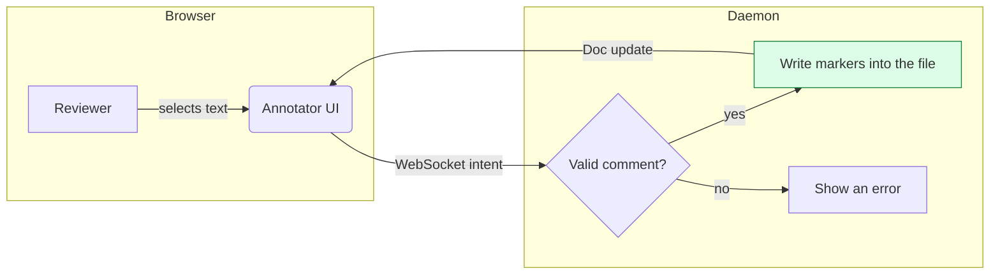
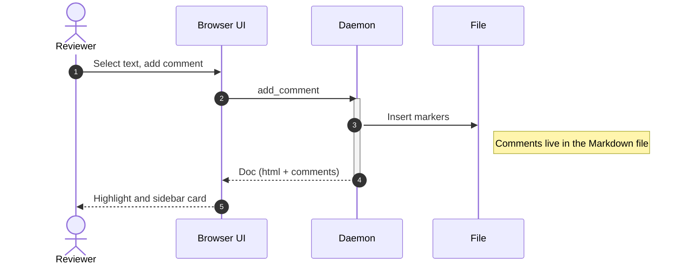
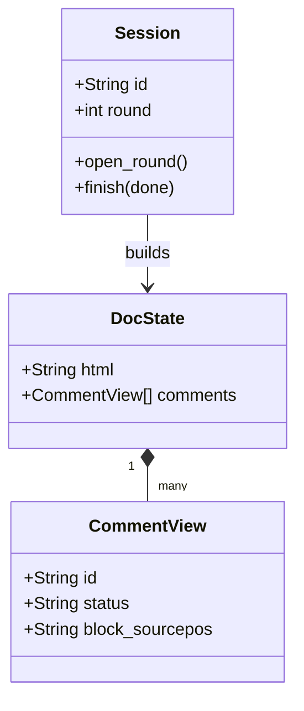
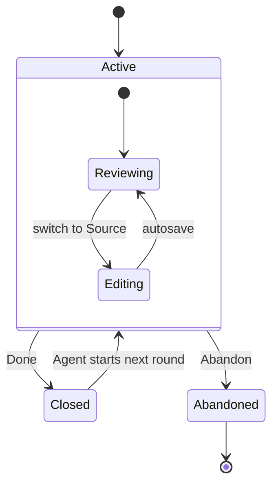
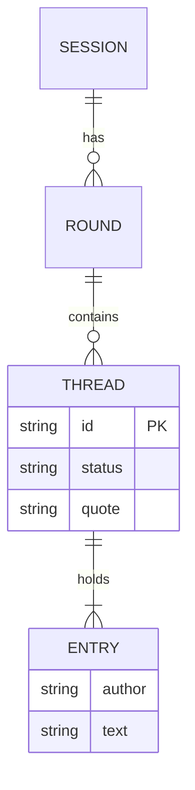
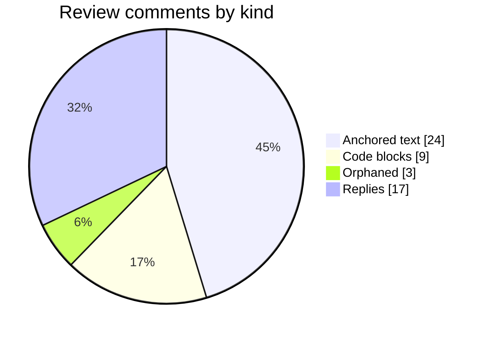
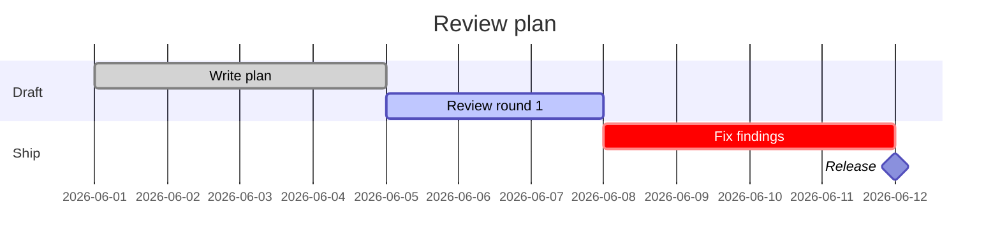

# Release plan

Select any text and right-click to leave a comment. Comments are stored in this file as HTML comments.

We should <!--c:k3f9-->ship on Friday<!--/c:k3f9--> regardless of the QA timeline, because the release window closes Monday.
<!--co:k3f9 by:kyle at:2026-06-17T10:00:00.000Z status:open quote:"ship on Friday"
kyle (2026-06-17T10:00:00.000Z): I thought we agreed Thursday?
sam (2026-06-17T10:05:00.000Z): Thursday is better for QA.
+👍 sam, mike
-->

Here is a second paragraph with <!--c:a7b2-->another highlighted span<!--/c:a7b2--> placed close to the first.
<!--co:a7b2 by:sam at:2026-06-17T10:05:00.000Z status:open quote:"another highlighted span"
sam (2026-06-17T10:05:00.000Z): Two anchors near each other.
-->

And a third point that is already <!--c:zz1q-->resolved<!--/c:zz1q-->.
<!--co:zz1q by:kyle at:2026-06-17T09:00:00.000Z status:resolved quote:"resolved"
kyle (2026-06-17T09:00:00.000Z): Handled.
-->

## Code

<!--c:p7k2-->
```python
def process(order):
    validate(order)
```
<!--/c:p7k2-->
<!--co:p7k2 by:agent status:open quote:"    validate(order)" line:1
agent: should this run before logging?
-->

This body has no anchor any more.
<!--co:orph1 by:me at:2026-06-17T12:00:00.000Z status:open quote:"deleted text"
me (2026-06-17T12:00:00.000Z): orphaned thread
-->

Example syntax in a fence is ignored:

```markdown
<!--c:ex01-->example span<!--/c:ex01-->
<!--co:ex01 status:open
me: not a real comment
-->
```

## Diagrams

Mermaid fences render as diagrams. Hover one for **Comment** / **Source**; click it to zoom.

### Flowchart

<!--c:mm01-->

<!--/c:mm01-->
<!--co:mm01 by:agent at:2026-06-17T11:00:00.000Z status:open quote:"flowchart LR" line:0-11
agent (2026-06-17T11:00:00.000Z): Should the error path also notify the agent?
-->

### Sequence diagram



### Class diagram



### State diagram



### ER diagram



### Pie chart



### Gantt chart



### An invalid diagram

```mermaid
flowchart LR
  A --> B
  B -->> C
  C[unclosed
```
